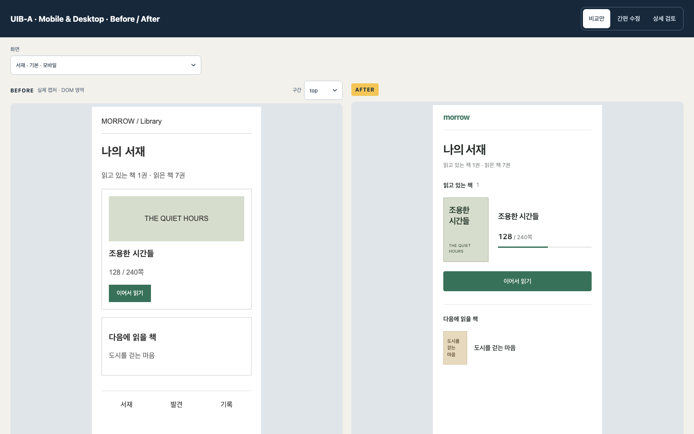
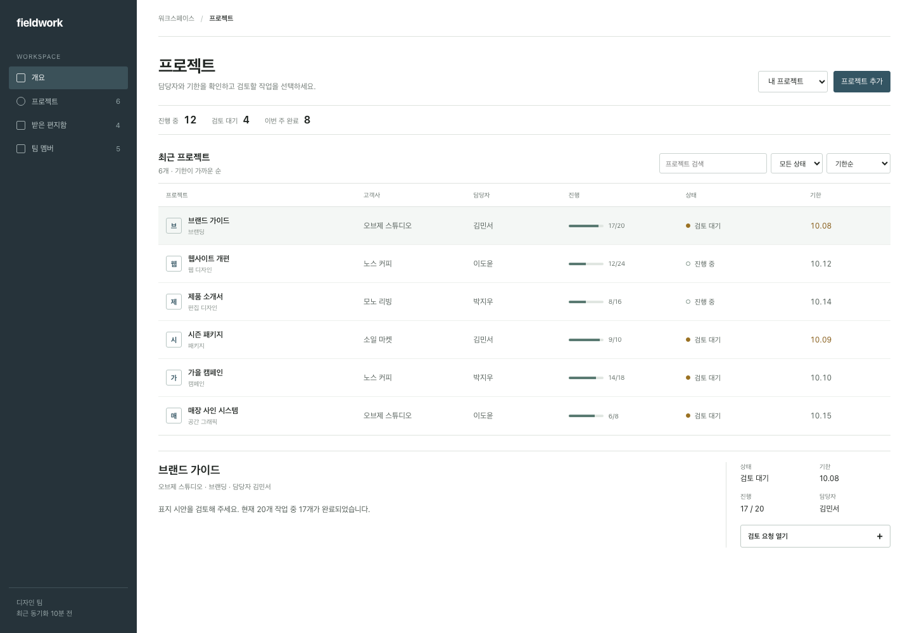
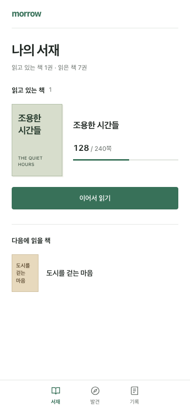
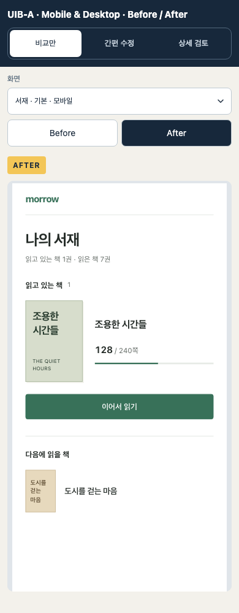

<div align="center">

# uib-a

### Capture your current UI, compare a proposal, and save the review

**UI Before / After — mobile and desktop mockups with review tools in one offline HTML**

[](LICENSE)
[](package.json)
[](SKILL.md)

[한국어](README.md) · **English**

[Preview](#preview) · [Quick start](#quick-start) · [Three modes](#modes) · [Save and iterate](#save) · [Docs and tools](#docs)

</div>



- **Input:** your existing project, screens, brand, and usability task
- **Output:** one HTML containing genuine Before captures, an After proposal, and review state
- **Review:** browser-based comparison, selection, temporary removal, preview edits, comments, and saving
- **Use cases:** design decisions before implementation, mobile/desktop review, and another iteration from a saved file
- **Production changes:** a separate implementation request after reviewing the proposal

```text
Current screens + user tasks + brand evidence
                     ↓
        Before captures + justified After
                     ↓
Compare only → Simple edits → Advanced review as needed
                     ↓
       Save HTML → share with Codex → next proposal
```

<a id="preview"></a>

## Preview without installation

**[Download the demo HTML](https://raw.githubusercontent.com/99duuk/uib-a/main/docs/demo/before-after.html)**

1. Save the linked content as an `.html` file.
2. Open the saved file in your browser.
3. Select a screen, compare Before/After, and switch to an editing mode when needed.

- HTML review: no server, Node.js, or Codex requirement
- Fictional examples: mobile library, reading confirmation modal, desktop project home, mobile project home
- Fieldwork: the same specification and fixture on both sides; Morrow: a revised After with its previous Before retained
- [Demo decisions and sources](docs/design-notes.md), with no customer screenshots, claimed rankings, or conversion evidence

<details>
<summary><strong>After proposals and mobile reviewer</strong></summary>







</details>

<a id="quick-start"></a>

## Installation and first use

### 1. Install the skill

- Requirements: Codex, Node.js 22+, npm, and Git
- Internet access: dependency installation and project-specific reference research

```sh
git clone https://github.com/99duuk/uib-a.git
cd uib-a
npm run install:skill
```

- Destination: `$CODEX_HOME/skills/uib-a`, or `~/.codex/skills/uib-a` when unset
- Dependency installation: handled by the installer
- Existing destination: installation stops by default without overwriting
- Custom destination: `npm run install:skill -- /absolute/path/uib-a`

<details>
<summary><strong>Update an existing installation</strong></summary>

Check local changes in the source checkout before updating:

```sh
git pull --ff-only
npm run install:skill -- --replace
```

- `--replace`: active directory switch after successful staging and dependency installation
- Previous copy: preserved outside the active skill directory; `skills-backups/` for the default destination
- Custom destination: `npm run install:skill -- /absolute/path/uib-a --replace`
- After installation: a new Codex conversation in the target project

</details>

### 2. Invoke it in your project

In a new Codex conversation with your project open:

```text
$uib-a Improve the customer start screen and desktop admin home.
Inspect the actual screens, identify the user's next task and information that is hard to find.
Keep the existing data and brand, and propose a layout that addresses those problems.
Explain the placement decisions and put Before/After in one HTML.
Keep production code unchanged and give me the absolute HTML path.
```

- Workflow: project discovery → genuine captures → design evidence → After → HTML generation and verification
- Project preparation: a runnable app and accessible target screens
- Missing capture browser: preparation of the required Playwright browser
- [Full skill workflow](SKILL.md)

### 3. Review the HTML

1. Open the delivered HTML and select a screen, device, and state.
2. Compare Before/After in the default **Compare only** mode.
3. Switch to **Simple edits** and select an element.
4. Change text, text color, or font size and apply it; or temporarily remove the element and leave a request.
5. Switch to **Advanced review** for detailed comments, decisions, imports, and exports.
6. Save reviewed HTML, confirm the browser download, and reopen the saved file.

Current toolbar labels and detailed reference guides: Korean. English project requests: supported by the skill.

<a id="modes"></a>

## Three modes, as needed

| Mode | Main tasks | Tool visibility | Background |
| --- | --- | --- | --- |
| **Compare only** · default | Screen selection, Before/After, scrolling | Editing panels hidden; selection and edits blocked | Neutral |
| **Simple edits** | Single selection, remove/restore, text/color/size edits, short requests, undo/redo | Editors shown after selection | Pale green |
| **Advanced review** | Multiple/area/text comments, replies, decisions, properties, comparison settings, files | Expand the relevant tool groups | Pale purple |

- Mode buttons: consistent header position, labels and selected state alongside color cues
- Switching modes: retention of removals, applied edits, comments, drafts, and current-session history
- Desktop default: side-by-side comparison
- Mobile default: Before/After tabs, with After shown first
- Saved-file reopening: saved results in Compare only mode
- Save button in Compare only: visible when unsaved changes exist

### Simple edits

| Target | Available actions |
| --- | --- |
| Editable text/elements in authored After | Text, text color, font size, temporary removal, requests |
| Before or captured After | Masking screenshot regions, restoration, requests |
| Hard-to-target elements | Selection through the element list |

- After removal: DOM hiding with layout reflow
- Before removal: region masking with the original image retained
- Restoration: change history, individual recovery, undo/redo
- Direct editing: allowed authored After elements; no editing text or styles inside screenshot pixels
- Effect: review HTML only; live product changes require implementation

<details>
<summary><strong>Advanced tools</strong></summary>

| Tool group | Contents |
| --- | --- |
| Comparison | Side/single view, fit/100%, wipe/overlay/pixel diff, original/current results |
| Elements and edits | Ancestors, screen/ID/revision/locator copying, allowed styles, design tokens, embedded images |
| Comments | Element/group/text/area/screen targets, author, priority, replies, resolve/reopen |
| Decisions | Approval/change request, reasons, batch decisions, stale approvals after relevant changes |
| Files and handoff | Review JSON, same-bundle import with conflict selection, Markdown/JSON, PNG, element index |
| Local experience | Declared mockup transitions and local details controls |

- Raster comparison tools: compatible raster inputs only
- Local experience: declared transitions, without original app scripts or server writes
- PNG: embedded raster export in the browser; trusted current After reconstruction through the CLI
- Imports: explicit conflict review and selection

</details>

<a id="save"></a>

## Saving and another iteration

| Situation | Result or requirement |
| --- | --- |
| Mode switch | Current review results and drafts retained |
| Text/style values entered but not applied | Session-only input retention; **apply before saving** |
| Save reviewed HTML | New download containing original assets, comments/replies, comment drafts, decisions, removals, applied preview edits |
| Reopen a saved file | Saved results and original restoration available; no guarantee of previous-session undo/redo history |
| Refresh or close before saving | Possible loss of changes since the last file save |

- No automatic saving or dependency on `localStorage`
- Unapplied text/style inputs: no saved-file persistence guarantee
- Download-start message: no guarantee of disk-write completion; browser download confirmation required

```text
$uib-a Use the attached review HTML and copied element details for the next iteration.
Apply the comments and removal intent; increment only the changed screen's revision.
Preserve untouched screens and genuine Before captures.
Give me the absolute path to the new Before/After HTML.

[Element details copied from the reviewer]
```

<details>
<summary><strong>More prompt examples</strong></summary>

**Specification first**

```text
$uib-a Identify where users get stuck in the current screens.
Specify the information to retain, layout changes, and reasons.
Do not create mockups or change production code yet.
```

**Mobile and desktop**

```text
$uib-a At 390px, make the current state and next action easy to find.
At 1440px, make work items, owners, and deadlines easy to compare.
Use existing information and deliver both in one Before/After HTML.
```

**Add screens**

```text
$uib-a Add settings and billing screens to this review HTML.
Preserve the existing proposals, Before captures, and review format.
```

</details>

## Design criteria

- User, next action, required information, current friction, and brand evidence before layout work
- Reference comparison by task and information density
- Existing data, terminology, required content, consent, and confirmation flows retained
- A specific purpose for each placement, image, color, and decoration
- No decorative English, invented metrics, or purposeless card groups
- Bundled examples as demonstrations, with no universal palette or layout template
- Sources, observation times, public reaction counts, and adoption/rejection reasons recorded
- [Design contract](references/design-contract.md) · [Layout and copy criteria](references/product-design.md) · [Research workflow](references/workflow.md)

<a id="docs"></a>

## Documentation and CLI tools

| Purpose | Guide |
| --- | --- |
| Full skill workflow | [SKILL.md](SKILL.md) |
| Evidence, alternatives, required content | [Design contract](references/design-contract.md) |
| Layout, copy, visual review | [Design criteria](references/product-design.md) |
| Capture, manifest, rebuilding | [Authoring](references/authoring.md) · [JSON schema](references/manifest.schema.json) |
| Selection, edits, decisions, saving | [Review contract](references/review-contract.md) |
| Verification and limitations | [Acceptance](references/acceptance.md) |
| Third-party reuse and notices | [THIRD_PARTY_NOTICES.md](THIRD_PARTY_NOTICES.md) |

<details>
<summary><strong>Generate the local demo</strong></summary>

From the source checkout:

```sh
npm ci
# If Chromium is missing; preserve other projects' browser caches
PLAYWRIGHT_SKIP_BROWSER_GC=1 npx playwright install chromium
npm run demo
```

- Output: `output/demo/before-after.html`
- Fresh destination: `npm run demo -- output/demo-2`
- Bundled Before captures reused, After rebuilt from example sources
- Project work: its own genuine screen captures required

Windows PowerShell browser installation:

```powershell
$env:PLAYWRIGHT_SKIP_BROWSER_GC = '1'
npx playwright install chromium
```

- Linux dependencies: [Playwright browser installation](https://playwright.dev/docs/browsers)

</details>

<details>
<summary><strong>Capture, build, verify, extract, and export</strong></summary>

```sh
node scripts/capture.mjs /path/to/capture-config.json /path/to/captures
node scripts/build.mjs /path/to/manifest.json /path/to/review-1
node scripts/verify.mjs /path/to/review-1/before-after.html
node scripts/extract.mjs /path/to/saved-review.html /path/to/editable
node scripts/design-search.mjs --query "keyboard focus"
node scripts/export-review.mjs /path/to/saved-review.html /path/to/handoff --format md
node scripts/export-review.mjs /path/to/saved-review.html /path/to/png --format png --view current
npm run package
```

- Relative input paths: resolution from the configuration file
- Outputs: fresh directories for existing-result preservation
- Continuation: changed-side revision increment and previous bundle/state reconstruction
- Extraction and current PNG: validated data processing instead of executing supplied app code
- Capture resume: reuse gated by matching source, configuration, local resource, and artifact hashes
- Format compatibility: v1 reading and v2 writing; no v2 support in old v1 tools
- Packaging: local archive creation, without automatic publishing

</details>

## Scope and limitations

- HTML/CSS proposals without a required target-project framework
- Before without a DOM map: whole-image selection or explicitly authored manual regions
- Missing Before: explicit missing-original label; no invented screen presented as a genuine capture
- Raster rectangle maps: visual checks for complex transforms and occlusion
- Generated-artifact verifier: Chromium-based; functional passes alone insufficient for design-quality claims
- Three-mode checks: Chromium, Firefox, WebKit; 2.1.1 alignment/background checks at widths from 320 to 1600px
- WebKit results: no substitution for physical Safari/iOS testing
- Physical touch hardware, VoiceOver, other operating systems: separate verification required
- References: publicly observable candidates and metrics; no global popularity rankings or conversion guarantee
- Verification claims: the individual artifact's report as the source of evidence

## Contributing and license

- [Issues](https://github.com/99duuk/uib-a/issues): browser, OS, steps, expected behavior, and a minimal anonymized example
- Pull requests: change rationale and checked behavior
- Excluded materials: project-specific captures, authentication files, `node_modules/`, `output/`
- [MIT License](LICENSE) · Copyright © 2026 99duuk
- Dependencies, external designs, fonts, and images: their respective license terms
- Community project, unaffiliated with OpenAI and Dribbble
