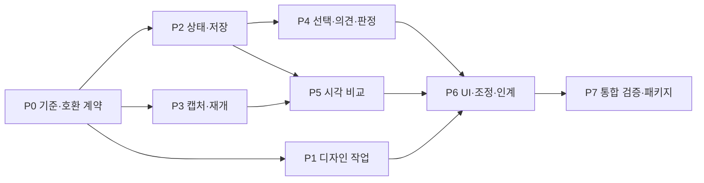

# uib-a 구현 계획

- 상태: 계획 완료 대상·기능 구현 미착수
- 기준: `de59afcfa3b1e357ab978c3dc55f2ed08dc2dbf5` · 2026-10-13
- 작성 브랜치: `docs/evolution-plan`
- 계약: [SPEC.md](SPEC.md) F01~F18 · 근거: [COMPARISON.md](COMPARISON.md)
- 전체 목표: 명세의 모든 채택 항목과 기존 동작의 함께 충족
- 단계 완료의 의미: 전체 구현으로 가는 중간 점검; 이후 단계의 사용자 재요청 의존 종료 금지

## 1. 구현 결정

| 영역 | 선택 | 근거 |
| --- | --- | --- |
| 프레임워크 | 현재 정적 HTML·CSS·JavaScript 유지 | 단일 파일·sandbox·Vue/React 독립성 |
| 상태 | 한 canonical review state와 순수 변경 함수 | 저장·undo·판정·import의 중복 로직 방지 |
| schema | v1 읽기 + v2 쓰기 | target union·판정·patch·capture형 After의 직렬화 변경 |
| 캡처 | 기존 Playwright 확장 | 기존 보안·상태 adapter·브라우저 설치 재사용 |
| 비교 | pixelmatch의 빌드 시 실행 | 직접 픽셀 비교 알고리즘 구현 회피·런타임 의존 제거 |
| PNG | 기존 Playwright의 브라우저 Canvas decode/encode 우선 | native sharp·중복 PNG decoder 추가 회피 |
| 후보 요소 | 캡처 시점 영역 맵의 교차 계산 | 별도 페이지 재방문의 상태·scroll 불일치 방지 |
| 검색 | 검토된 자료 subset + Node 조회 | Python 환경·거대 추천 엔진의 강제 도입 회피 |
| 소스 맥락 | 선택적 capture adapter | React 내부 코드의 기본 리뷰어 결합 회피 |
| 스타일 편집 | 허용 token/style/text patch | GrapesJS 전체 편집기와 실행 앱 권한의 도입 회피 |
| 배포 | 로컬 skill 패키지·설치 일치 확인 | 별도 서버·계정·원격 협업 없이 기본 과제 충족 |

- Canvas decoder 검증: sRGB RGBA8·투명도·DPR fixture에서 decode/encode·diffMask bbox 확인
- Canvas 경계 실패 시 대안: `pngjs`의 정확한 버전·LICENSE·추가 의존 검토 후 채택; 두 decoder 동시 지원 기본값 제외
- 직접 코드 후보: React Grab의 작은 순수 bounds 함수, UI UX Pro Max의 검토된 가이드 데이터
- 각 후보의 최종 선택: 현재 함수 재사용/플랫폼 API/의존 도입/원문 수정 중 가장 작은 완성 경로

## 2. 의존 순서

- 추천 구현 순서: P0 → P2 → P4 → P1 → P3 → P5 → P6 → P7
- 초반 사용자 가치: 데이터 손실 없는 의견·판정·저장과 기존 선택 UX 개선
- 병렬 가능 범위: P0 이후 디자인 자료/문서, 캡처 코드, 상태 모델의 독립 작업
- 동시 수정 금지 파일: `scripts/build.mjs`, `scripts/lib.mjs`, `assets/reviewer/viewer.js`, `scripts/verify.mjs`
- 각 병렬 작업 완료 후 메인 담당의 계약·통합·최종 판정

## 3. 단계별 작업·완료 조건

### P0 — 기준·데이터·재사용 목록 확정

- 담당 범위: `references/manifest.schema.json`, 신규 `references/{bundle,review-state,design-contract}.schema.json`, `references/review-contract.md`, `references/acceptance.md`, 라이선스 목록, 기존 fixture
- 실행 내용:
  - v1 demo·저장된 삭제본·missing/image/manual Before fixture의 기준 hash 고정
  - 입력 manifest·bundle·review state·capture config·design contract의 필드와 버전 이행 정의
  - 기존 `brand/research/coverage`와 새 디자인 계약의 사실 중복 제거
  - 실제 편입할 source path·SHA·LICENSE·NOTICE·수정 여부·내장 범위 목록
  - 버전 `1.1.1` 설치본/소스 차이와 패키지에 유입 가능한 `.DS_Store`·비추적 문서 조사
- 완료 조건:
  - v1→v2 필드 대응표·거절/미해결 조건·trust boundary 확정
  - 각 F 항목의 변경 파일·수용 사례·도입 출처 연결
  - 코드/자료 편입 전 해당 파일의 재배포 조건 확인
- 단계 의존: 없음

### P1 — 디자인 계약·자료 검색·시안 평가

- 담당 범위: `SKILL.md`, `agents/openai.yaml`, `references/{workflow,product-design,authoring}.md`, 신규 `references/design-contract.md`, `data/design-guidance/`, `scripts/design-search.mjs`
- 실행 내용:
  - 요청 분기: 명세만 / 리디자인 제작 / 검토 후 수정 / 개발 인계
  - 제품 사실·시각 원칙·유지 제약·근거 confidence의 짧은 계약 작성
  - Impeccable의 과제 중심 대안·P0~P3 비평 방식의 기존 문서 통합
  - 검토된 UX 데이터의 한국어/영문 태그·원본 ID·출처·반례 연결
  - `--query`·선택 domain을 받는 로컬 검색, match/no-result 구분; 자동 레이아웃 강제 없음
  - 사용자 지시·기존 명세·브랜드·직접 관찰·검색 후보의 우선순위 명시
  - 같은 데이터·상태의 실질 대안과 이전 지적 대비 수정 결과 기록
- 완료 조건:
  - 계약만 전달받은 작성자의 필수 필드·동선·브랜드 일치 시안 작성 가능
  - 프로젝트별 기존 스타일 보존과 명시적 재구성 요청의 구분
  - 한국어/영문 알려진 UX 과제 5종의 검토된 관련 레코드 조회·무관 질의 1종의 no-result 출력, 전부 no-result의 통과 금지
  - 비평 지적의 실제 화면·revision 근거와 미관찰 항목 표시
  - A15·A19의 필수 정보 보존·실질 대안·비평→수정→재비평 및 save/extract/handoff 연결
- 기능: F01~F03
- 단계 의존: P0; P2와 독립 진행 가능

### P2 — 상태 v2·이행·저장·undo/redo

- 담당 범위: `scripts/lib.mjs`, 신규 `scripts/review-state.mjs`, `scripts/{build,extract}.mjs`, `assets/reviewer/viewer.js`, schema 파일
- 실행 내용:
  - 하나의 순수 상태 모듈에 validate/migrate/apply/merge/rebase 기능 배치
  - Node 빌드·추출과 HTML 리뷰어의 동일 계약 사용; 저장용 별도 상태 변환기 중복 방지
  - `jsonScript`·asset hash·revision 검증의 유지·확장
  - v1 deleted/unresolved 이행, v2 annotation/decision/previewEdit 보존
  - current bundleHash 일치 import의 충돌 미리보기와 항목별 해결
  - 다른 revision target의 unresolved 보존과 명시 재연결
  - 세션 undo/redo·batch transaction·새 행동 시 redo 가지 초기화
  - 원본 shell+bundle+state 기반 저장, 저장 후 dirty 표시 갱신
- 완료 조건:
  - A01~A05·A09의 데이터 손실/오적용 없음
  - v1 저장본의 v2 저장·추출·재빌드 round trip
  - 악성 의견·깨진 state·unknown version·부모 cycle·다른 bundle import의 명시 처리
- 기능: F10·F11·F17 기반
- 단계 의존: P0

### P3 — 캡처 계약·재개·진단

- 담당 범위: `scripts/capture.mjs`, 신규 `references/capture.schema.json`, `scripts/lib.mjs`의 합의된 IO helper, capture fixture
- 실행 내용:
  - 기존 trusted adapter 경로 유지와 target/tile ID·중복 검증
  - 안정화 profile·deadline·단계별 진단·target 실패 격리
  - navigation 전 정지 규칙과 타일 준비 이후 fonts/images 재대기
  - DOM fallback 순번 key의 revision-local 표시; sourceRevision/manifest revision 대응 확인
  - capture record fingerprint·PNG/map hash·원자 완료 기록
  - `--resume <이전-run>`의 읽기 전용 재사용과 새 run 산출
  - iframe/shadow/canvas 미지원 내부의 영역 fallback·coverage 사유 표시
  - 제한된 동시 context 실행의 상한과 finally 정리
- 완료 조건:
  - A06~A08의 실패 격리·fingerprint 변경·손상 재개·좌표 일치
  - 승인되지 않은 쓰기 요청·자동 Git worktree 생성 없음
  - sourceRevision 미제공 시 안전한 재캡처 또는 adapter 제공 콘텐츠 fingerprint 필요
- 기능: F04·F05·F14의 adapter 기반
- 단계 의존: P0; 공유 helper 수정은 P2 담당과 순차 통합

### P4 — 선택·코멘트·화면 판정

- 담당 범위: `assets/reviewer/{frame.js,viewer.js,shell.html,viewer.css}`, P2 상태 모듈 호출부
- 실행 내용:
  - 선택과 clipboard 복사의 분리
  - 다중 선택·계층 목록·사각 영역·텍스트 anchor·화면 의견
  - hover·선택·삭제·의견 핀·마스크의 시각/입력 우선순위
  - 의견/답글 추가·수정·삭제·해결/재열기·우선도·draft의 화면별 보존
  - 작성 DOM의 motion pause/resume·computed style/spacing 검사와 Before 수집값 구분
  - 화면/variant 판정과 원본+entry별 deleted/previewEdits의 visibleStateHash 변경 시 needs-review
  - 근거·확신 수준·변경 후보의 상세 패널 연결
  - bbox 순수 함수의 필요 시 선별 재사용과 고지
- 완료 조건:
  - A02~A05·A09~A11의 saved state·다중 조작·revision 만료·입력 비간섭
  - Before region 의견과 After DOM 의견의 동등한 저장
  - 선택할 수 없는 DOM/텍스트의 명확한 fallback
- 기능: F07~F10·F15의 기반
- 단계 의존: P2

### P5 — 실제 화면 비교·diff·증거 출력

- 담당 범위: 신규 `scripts/compare.mjs`, `scripts/build.mjs`, `scripts/capture.mjs`의 공통 경로, reviewer compare UI, `package.json`·lock
- 실행 내용:
  - 작성 After의 원본 raster 캡처와 실제 앱 After capture 지원
  - 현재 위젯 변경 전 원본 비교용 이미지의 asset dedupe
  - pixelmatch ISC 고지·정확한 lock·diffMask 기반 bbox
  - 비교 가능성 판정과 이유 목록; 다른 크기의 자동 padding 금지
  - 슬라이더·opacity overlay·diff·확대·동기 scroll; 선택 모드와 구분
  - bbox→캡처 당시 region의 복수 후보 계산·추정 표시
  - 브라우저 Canvas의 내장 원본/비교/영역 PNG 출력; 주석 overlay 포함 여부 선택
  - `scripts/export-review.mjs`의 saved HTML→오프라인 Playwright→현재 After frame PNG 경로; DOM reflow·text/style patch 렌더
  - CLI의 새 결과 디렉터리·원본 saved HTML hash·current/original view 표시; runtime DOM rasterizer 도입 없음
- 완료 조건:
  - A07·A08·A12의 diff 정확성·원본/검토 구분·export 크기/좌표
  - HTML 열기 시 외부 모듈·서버 없는 모든 비교 기능
  - 삭제/빠른 조정 뒤 오래된 raster의 현재 상태 오인 없음
- 기능: F06·F16
- 단계 의존: P2·P3; P4와 통합 시 frame message 타입 고정

### P6 — 검토 UI·빠른 조정·인계

- 담당 범위: reviewer 4개 파일, 신규 `scripts/export-review.mjs`, 소스 adapter 예시, README·사용법
- 실행 내용:
  - 화면 탐색/진행 상태·집중 캔버스·의견/변경/근거 패널
  - 3영역 desktop·접이식 tablet·한쪽 탭/bottom sheet mobile
  - 목록/필터/단축키·터치·한글 IME·포커스와 오류 복구
  - 작성 After의 text/token/spacing/alignment/asset patch preview
  - patch의 원본 base 확인·undo/redo·저장·다음 revision 반영
  - 공통 sourceHint + React 선택 adapter + Vue/일반 DOM 제공 metadata 예시
  - Markdown/JSON 요청 export와 동일 schema; 사용자 지정 경로 밖 자동 이슈 발행 없음
  - 계약·비평·판정·필수 유지 콘텐츠를 포함한 다음 작성자 인계
- 완료 조건:
  - A10~A16의 모바일·접근성·patch·source fallback·인계
  - 320px에서 조작 메뉴 접근, 200% 확대에서 제어 기능 접근
  - 현재 baseline 대비 긴 ID·필터·선택 패널의 상시 점유 축소 확인
- 기능: F12~F15와 F01~F11 통합
- 단계 의존: P1·P4·P5

### P7 — 통합 검증·배포물·설치 일치

- 담당 범위: `scripts/{verify,demo,package,install}.mjs`, `examples/`, docs/demo·이미지, README 2종, package metadata·license
- 실행 내용:
  - 기존 verify의 실사용 회귀 보존·아래 수용 사례 추가
  - Node 내장 test runner의 상태/이행/비교 소규모 검사; 새 테스트 프레임워크 도입 없음
  - desktop·mobile·image-only·긴 콘텐츠·중첩 scroll·다른 revision fixture
  - Chromium 자동 검사와 WebKit/Firefox 저장·선택·키보드 수동/자동 최소 smoke
  - 실제 320/390/768/1440 화면·터치·키보드·screen reader 기본 탐색 기록
  - 50 entry 규모의 크기·메모리·응답 측정과 고지
  - package 재귀 포함에서 `.DS_Store`·임시 파일·조사 원문·출처 없는 자산 제외
  - `sourceBuild` SHA·파일 hash 목록·THIRD_PARTY_NOTICES·관련 licenses 포함
  - v2 format의 `2.0.0` 후보 릴리스; 실제 릴리스 시 기존 v1 읽기 호환과 이전 도구의 v2 미지원 명시
  - 새 경로 설치 검증 후 기존 설치본 백업·활성 경로 갱신; 사용 중 source와 설치본 hash 비교
- 완료 조건:
  - A01~A19 통과 또는 미완료 명시와 완료 보류
  - 실제 실행한 브라우저·OS·fixture·source SHA·package SHA 증거
  - 패키지와 양쪽 사용 대상 skill 경로의 일치, 기존 설치본 보존
- 기능: F17·F18 및 전체 완료
- 단계 의존: P6

## 4. 수용 시나리오

| ID | 입력·동작 | 기대 결과 | 기능 |
| --- | --- | --- | --- |
| A01 | 기존 v1 demo·삭제 저장본 → extract → v2 build | entry·Before·원본 자산·삭제 의도 보존; 새 필드 기본값 | F11·F17 |
| A02 | 의견·판정·삭제·patch 저장 → 파일명/경로 변경 → 새 offline context | 동일 상태·원본 복원·외부 HTTP 0건·localStorage 불필요 | F08~F12 |
| A03 | 자식/부모 삭제·부모 복원·다중 삭제·undo/redo | 자식 의도 보존·batch 1회 undo·새 수정 뒤 redo 초기화 | F07·F10 |
| A04 | R1 의견/승인 후 R2 content 변경·기존 ID import | 오래된 target 미해결·승인 needs-review·무변경 entry 유지; 같은 revision의 삭제/patch 뒤 승인 만료 | F09·F11 |
| A05 | 다른 review/bundle·중복 annotation ID·unknown schema·거대 JSON import | 거절/충돌 미리보기·기존 검토와 원본 보존 | F11·F17 |
| A06 | target A 성공·B timeout·C 성공 → 중단 → resume | A/C 완전 hash 확인 후 재사용·B만 재시도·실패 목록 표시 | F04·F05 |
| A07 | DPR·locale·fixture·adapter·source·scroll 변경 또는 PNG 손상 | fingerprint 불일치 재캡처; 타일/좌표 불일치 diff 비활성 | F04~F06 |
| A08 | 같은 흰 PNG·한 작은 영역 변경·AA·크기 불일치 | 동일 bbox null·변경 mask의 실제 bbox·불일치 이유 | F06 |
| A09 | 50%/100%·DPR2·nested scroll·sticky header·모달 | 올바른 ID·rect·텍스트 quote·다중 선택; 다른 frame 메시지 무시 | F07·F08·F17 |
| A10 | 320/390/768/1440px·200% 확대·모바일 키보드·touch drag | 캔버스 탐색·의견·판정·저장 가능·가려진 필수 버튼 없음 | F15 |
| A11 | Tab/Enter/Escape·IME 조합·입력창 undo·screen reader | 의미·포커스·상태 안내·본문 입력 이력 보존 | F07·F10·F15 |
| A12 | 원본 diff → After 삭제/patch → 저장 → CLI current PNG export | reflow·text/style 반영된 실제 frame PNG·원본/검토 결과 구분·bbox/크기 정확 | F06·F12·F16 |
| A13 | token/text patch 저장 → 추출 → 원본 반영 | base 불일치 거절·선택 patch 적용·revision 증가·판정 만료 | F11·F12 |
| A14 | React source adapter 없음·Vue metadata·image-only Before | source null 또는 근거 있는 hint·기본 리뷰 기능 정상 | F14 |
| A15 | 알려진 한글/영문 과제 5종·무관 질의 1종·브랜드 충돌 | 5종의 유효한 관련 결과·무관 질의 no-result·브랜드 우선 | F01~F03 |
| A16 | 코멘트/판정/미해결을 Markdown·JSON export → 다음 작성자 작업 | 동일 target/revision·요구·제약·근거·누락 없는 인계 | F13 |
| A17 | `</script>` 의견·외부 asset·path traversal·cycle·stale token | 실행/유출/경로 탈출 없음·명확한 오류·원본 보존 | F17 |
| A19 | 필수 가격/조건/상태를 가진 fixture → 2개 구조 대안 → P1 지적 → 수정·재비평 → 저장·추출·인계 | 필수 콘텐츠 전부 보존·색상 외 구조 차이·issue 해결/잔존과 revision 추적·근거 유지 | F01·F03·F11·F13 |
| A18 | 패키지 신규 설치 → demo/저장 검증 → 활성본 비교 | source/package/install hash 일치·관련 고지·이전 설치본 보존 | F18 |

- 기존 실행 기반: `npm run demo`, `npm run verify:demo`, `node scripts/verify.mjs <html> <evidence>`
- 추가 검사 위치: 순수 상태·비교 로직의 Node 내장 test와 기존 Playwright verifier; 동일 로직의 중복 자체 검증기 금지
- 시각 품질 확인: 같은 콘텐츠의 실제 전후 화면·필수 정보·첫 행동·다양한 상태; test 통과의 미감 대체 금지
- 독립 스킬 평가: 제품 과제·기존 화면만 제공한 평가자의 결과 관찰; 정답 문구·예상 패치 선공개 제외
- 현 계획 검토와 향후 기능 검증의 구분: 현재 A01~A19 실행 결과 없음

## 5. 변경 영향과 작업 책임

| 묶음 | 호출·문서·fixture 영향 | 주요 위험 |
| --- | --- | --- |
| 상태·schema | lib→build/extract→viewer→verify→authoring/review-contract | 검토 의도 손실·잘못된 revision 적용 |
| 캡처·비교 | capture→build/compare→assets→viewer→demo | 오래된 증거 혼입·좌표 불일치·메모리 |
| 디자인 작업 | SKILL→workflow/product-design→contract/search→examples | 일반 템플릿 편향·필수 정보 누락 |
| 검토 UI | shell/CSS→viewer/frame→state→save/export | 모바일 조작·focus·sandbox 경계 |
| 소스 연결 | capture adapter→elements.sourceHint→copy/export | 오인 소스 위치·비공개 경로 노출 |
| 릴리스 | package files→archive→install→README/metadata | 버전 같은 다른 내용·고지 누락·설치본 덮어쓰기 |

- 독립 병렬 담당 제안: 디자인 문서/데이터, 캡처/비교, 상태/리뷰어의 최대 3개 작업
- 메인 담당: 공유 계약·파일 충돌·사용자 범위·품질 판정·릴리스 일치
- 병렬 구현 시 공유 파일의 단일 소유자와 후속 통합 순서 지정
- scope 조정 필요 시 미완료 F 항목·원인·대안의 명시; 묵시적 삭제 금지

## 6. 종료·실패·복구

- 기준 artifact 보존: 모든 신규 결과의 새 run 디렉터리 생성
- 현재 정적 발견사항 우선 처리: saved state의 indexHash 미검사, 빈 요소 목록의 step 대상 접근, text 선택과 blanket keydown 차단의 충돌; 각 P2/P4의 회귀 사례 포함
- schema 오류: 입력 파일 유지·오류 경로와 값 종류 표시·부분 정상 저장 금지
- 캡처 오류: target 단위 격리·실패 stage 기록·성공 산출물 보존
- 비교 오류: 원본 보기 제공·diff 비활성 사유·자동 통과 없음
- 설치 오류: 이전 활성본 유지 또는 백업 복구·실패 패키지 출처 기록
- 반복 비평: 새 근거/개선 없는 반복의 중단과 잔존 이슈 기록; 미완료 요구의 성공 보고 금지
- 운영 영향: Bottling Worker·D1·Kakao·NFC·운영 배포 변경 없음
- 이번 문서 작업 종료: 비교·명세·계획의 출처/요구 추적 검토, 문서 commit/push, 구현 미착수 표기
